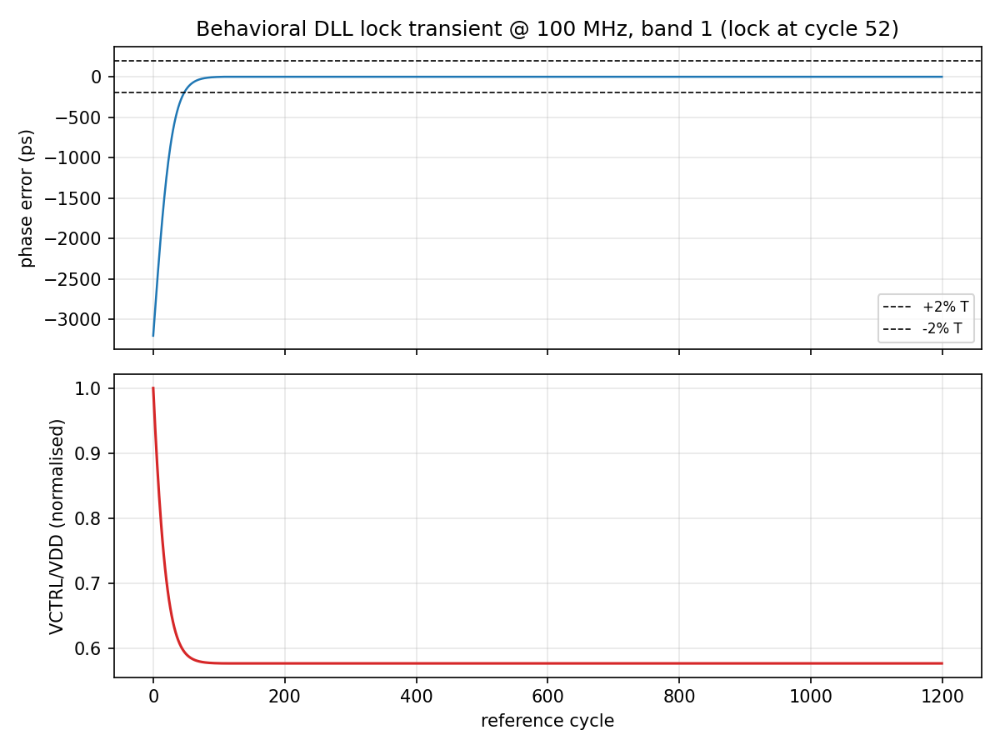
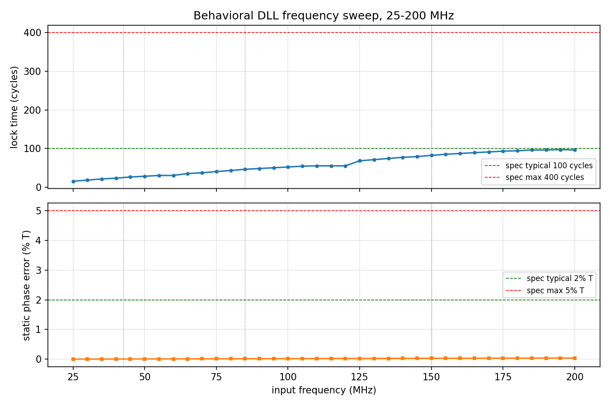
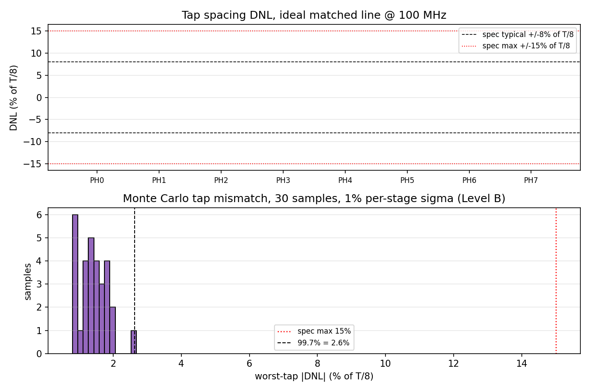
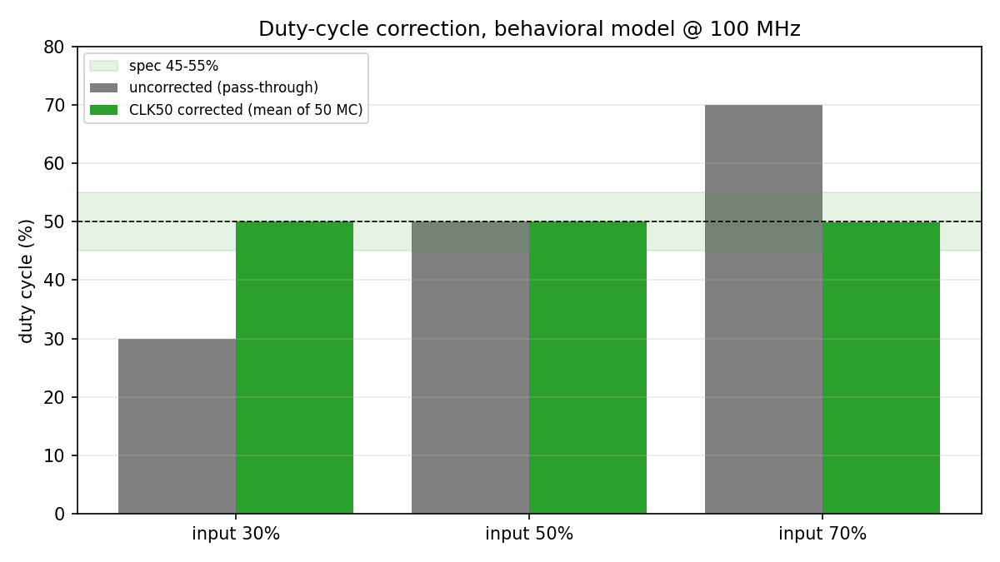
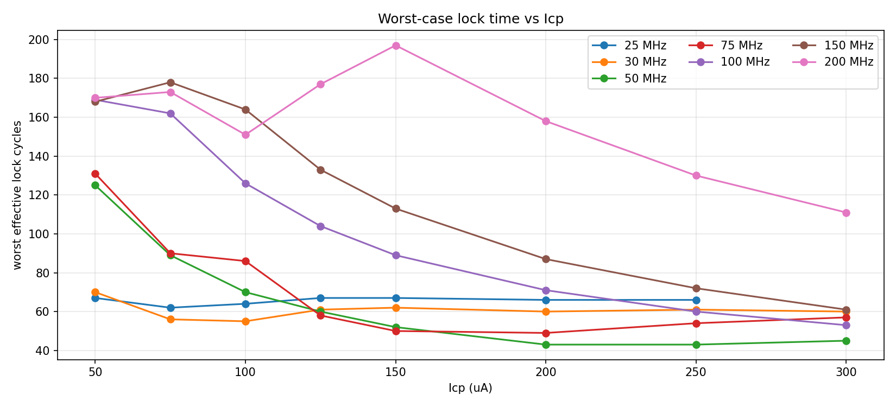

# Chipalooza Challenge #4: Eight-Phase DLL

## Overview

This repository documents a pre-layout feasibility study for an eight-phase analog and mixed-signal delay-locked loop targeting Sky130. It contains the baseline specification, architecture decisions, analytical calculations, behavioral models, acquisition controller investigations, verification reports, raw result tables, plots, and the competition proposal.

The repository is a technical record. It distinguishes proposed targets from analytical estimates, behavioral results, unverified items, and future implementation work. It does not claim transistor-level, post-layout, or silicon validation.

## Project objectives

- Generate eight evenly spaced clock phases from a reference clock.
- Target approximately 45 degree spacing between adjacent phases at a locked total delay of one reference period.
- Investigate a 25 MHz to 200 MHz operating range with overlapping frequency bands.
- Target the Sky130 process for eventual open-source implementation.
- Investigate an analog fine-delay loop with digital coarse acquisition.
- Identify acquisition failure modes before committing to a hardware implementation.

## Current project status

- This is currently a simulation and feasibility study.
- Evidence currently reaches Level A analytical and Level B behavioral.
- No Sky130 transistor-level validation has been completed.
- No layout, extraction, DRC, LVS, or post-layout validation has been completed.
- No silicon or hardware measurement has been completed.
- Area, power, jitter, output loading, phase accuracy, and tap-spacing compliance remain unverified at the physical implementation level.

The strongest work is in the behavioral acquisition investigation. The most important open problem is reliable coarse-to-fine handoff into the desired one-period lock region.

## Architecture

The investigated architecture contains the following elements:

- an eight-stage fine delay line intended to produce eight phase taps;
- phase-frequency detector and charge pump concepts for the fine loop;
- a loop capacitor model used in analytical and behavioral studies;
- a cycle-counting coarse acquisition controller prototype;
- a proposed handoff from coarse acquisition to fine-loop acquisition;
- lock-detection concepts based on observable signals;
- coarse actuator and control-voltage investigation, including DAC plus mux and switched-load alternatives;
- proposed monitors for tap selection, control voltage, and status.

Several of these elements exist only as behavioral models or proposals. In particular, the hardware acquisition FSM, coarse actuator, lock detector, output buffers, Sky130 delay cell, transistor-level PFD, and transistor-level charge pump have not been implemented.

## Target specifications

These are baseline targets, not achieved results. The governing baseline is `AGENTS.md`. The detailed status mapping is in `proposal/spec_compliance_matrix_v1.md`.

| Parameter | Target | Current status |
|---|---|---|
| Reference frequency | 25 MHz to 200 MHz | Behavioral evidence at sampled points; physical range unverified |
| Frequency bands | 25 to 60 MHz, 50 to 120 MHz, 100 to 200 MHz | Planning bands; hardware selection policy unresolved |
| Supply voltage | 1.62 V min, 1.80 V typ, 1.98 V max | Target only; no transistor-level sweep |
| Temperature | -40 C, 27 C, +110 C | Target only; no transistor-level sweep |
| Process corners | TT, SS, FF, SF, FS | Target only; no Sky130 corner models used |
| Phase outputs | 8 phases | Behavioral model only |
| Phase spacing | Nominal 45 degrees at one-period lock | Behavioral evidence only |
| Lock time | 100 cycles typ, 400 cycles max | Level B evidence under stated conditions |
| Static phase error | 2 percent of T typ, 5 percent of T max | Unverified physically |
| Tap-spacing DNL | 8 percent of T/8 typ, 15 percent of T/8 max | Behavioral assumption only; post-layout unverified |
| CLK50 duty cycle | 50 percent target, 45 to 55 percent allowed | Behavioral evidence only |
| Period jitter at 100 MHz | 25 ps RMS typ, 60 ps RMS max | Level A estimate only |
| Supply current | 1 mA typ at 100 MHz, 2 mA max at 200 MHz | Level A estimate only |
| Phase output load | At least 100 fF per phase | Target only; buffers not designed |
| False locks | Zero in startup tests | Limited behavioral observation only |
| Area | 0.05 mm2 or less | Unverified; no layout or credible physical area result |

## Evidence and results

All listed results are Level A analytical or Level B behavioral. No Level C transistor-level or Level D post-layout result is included.

| Area | Verified result | Level | Source path |
|---|---|---|---|
| Fine-loop exact-event validation | 98 convergence runs; one-period basin approximately 1.02T to 1.95T at 100 MHz, band 1, and 300 uA; timestep did not change the basin boundary | B | `results/pfd_validation/final_validation/report.md`, `results/pfd_validation/final_validation/tables/f2_convergence.csv` |
| Phase 3 controller study | 406 runs, 239 one-period acquisitions, 76 of 91 correct-band acquisitions, 0 of 13 at 25 MHz with 300 uA | B | `results/pfd_validation/acquisition_controller/report.md`, `results/pfd_validation/acquisition_controller/acquisition_results.csv` |
| Wrong-band behavior | 182 wrong-band main-matrix cases, 52 one-period locks, 130 failures, explained by overlapping modeled band delay ranges | B | `results/pfd_validation/acquisition_controller/acquisition_results.csv` |
| Phase 4 robustness sweep | 728 runs, 664 successes; at 200 uA, 91 of 91 successes with 7, 26, and 158 cycles as min, median, and max | B | `results/pfd_validation/acquisition_robustness/report.md`, `results/pfd_validation/acquisition_robustness/lock_time.csv` |
| Worst robustness case | 197 cycles at 200 MHz and 150 uA, not at the proposed 200 uA operating point | B | `results/pfd_validation/acquisition_robustness/lock_time.csv` |
| Frequency sweep | 36 points from 25 to 200 MHz; 15 to 97 lock cycles; static error 0.003 to 0.039 percent of T | B | `results/tables/frequency_sweep.csv` |
| Duty correction | Corrected means 49.99, 49.99, and 49.96 percent for 30, 50, and 70 percent input duty | B | `results/tables/duty_correction.csv` |
| Tap-spacing DNL | n equals 30, seed 7, assumed per-stage sigma 0.01; mean worst-tap DNL 1.43 percent of T/8; linear p99.7 2.63 percent | B | `results/tables/tap_spacing_100MHz.csv`, `scripts/run_behavioral.py` |
| Jitter estimate | At 20 mVrms supply noise, 25 ps and 60 ps RMS require supply sensitivity at or below 0.159099 and 0.381838 | A | `results/tables/jitter_sensitivity.csv`, `results/behavioral_dll.md` |
| Current estimate | 0.1 mA to 0.5 mA at 100 MHz from an assumed 30 fF per-stage load | A | `results/behavioral_dll.md` |

`results/pfd_validation/acquisition_robustness/lock_time.csv` is authoritative for lock-time statistics. Five medians in `current_sweep.csv` are documented discrepancies caused by an upper-middle selection for even-sized groups. The raw files were not changed.

### Evidence figures

| Figure | Source data |
|---|---|
|  | `results/tables/lock_band_midpoints.csv` |
|  | `results/tables/frequency_sweep.csv` |
|  | `results/tables/tap_spacing_100MHz.csv`, `scripts/run_behavioral.py` |
|  | `results/tables/duty_correction.csv` |
|  | `results/pfd_validation/acquisition_robustness/lock_time.csv` |

## Limitations

- The fine-loop acquisition basin is one-sided in the tested behavioral engine. Starts below the lower one-period boundary rail to minimum delay.
- Coarse count `k = 1` identifies a region only. It does not prove fine-loop handoff success.
- Wrong-band cases can still reach one-period lock in the behavioral model because the modeled band delay ranges overlap.
- The coarse actuator, electrical handoff, and hardware lock detector are not implemented.
- Physical delay-cell range and linearity are unknown.
- Loop gain, charge-pump current, and loop capacitor values are behavioral study values, not finalized circuit values.
- Current and area are estimates or unverified targets.
- Jitter is analytical only and depends on an assumed supply sensitivity.
- Output buffer load drive for 100 fF per phase is unverified.
- Harness interface, slot size, pad allocation, and pin multiplexing remain subject to official harness information.
- No transistor-level, post-layout, or silicon result supports hardware feasibility.

## Repository navigation

| Path | Contents |
|---|---|
| `AGENTS.md` | Original baseline specifications, engineering roles, and phase plan. Later sections were executed beyond the initial first-task stop. |
| `proposal/proposal_v1_submission.md` | Canonical final proposal text. |
| `proposal/architecture_decisions_v0.1.md` | Recorded architecture decisions D1 through D8. |
| `proposal/spec_compliance_matrix_v1.md` | Specification status map. |
| `scripts/` | Behavioral models, validation engines, runners, and container inspection helpers. |
| `results/` | Reports, plots, CSV tables, JSON metadata, and logs from the feasibility study. |
| `docs/` | Public-release audit and publication manifest. |
| `README_submission.md`, `README_submission_v2.md` | Historical submission and reproduction notes retained in the working tree but excluded from this public Git repository. |

Historical reports and drafts are retained for traceability. Some contain superseded statements that were corrected in later files. The canonical final proposal is `proposal/proposal_v1_submission.md`.

The competition submission ZIP and generated `submission_package/` directory are local snapshots, not source material. They are preserved locally and excluded from public Git by `.gitignore`. Their checksums were not changed during public-release cleanup.

## Reproduction

Run all commands from the repository root. These scripts rewrite files under `results/`, so reproduce from a clean repository copy if the committed raw outputs must be preserved.

Verify the local Python environment:

```sh
python --version
python -c "import numpy, scipy, matplotlib; print(numpy.__version__, scipy.__version__, matplotlib.__version__)"
```

Run the main behavioral and validation scripts:

```sh
python scripts/run_behavioral.py
python scripts/pfd_validation/run_acquisition_tests.py
python scripts/pfd_validation/run_robustness_sweep.py
python scripts/pfd_validation/run_final_validation.py
```

Optional detector unit checks:

```sh
python scripts/pfd_validation/test_pfd.py
python scripts/pfd_validation/test_pfd_v3.py
```

The committed scripts contain the fixed random seeds used for the published result tables: NumPy seeds 7, 11, and 3 in `scripts/run_behavioral.py`, and Python seed 20261121 in `scripts/pfd_validation/run_acquisition_tests.py`. The public audit records which historical local files contain machine-specific paths and were not used as canonical reproduction instructions.

## License

This repository is licensed under the Apache License 2.0. See `LICENSE`.

## Author

Amrit Tiwari
