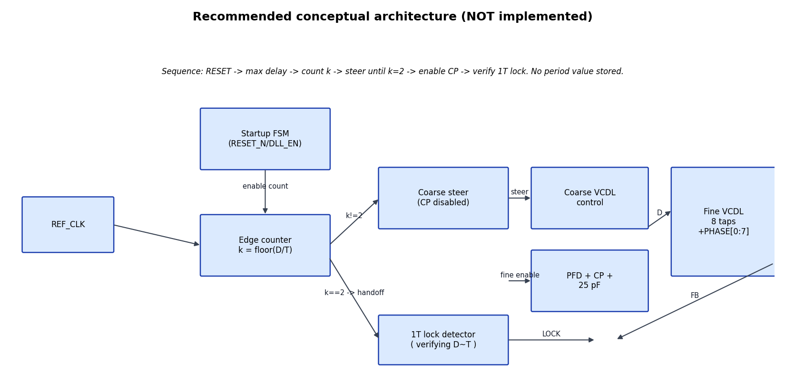
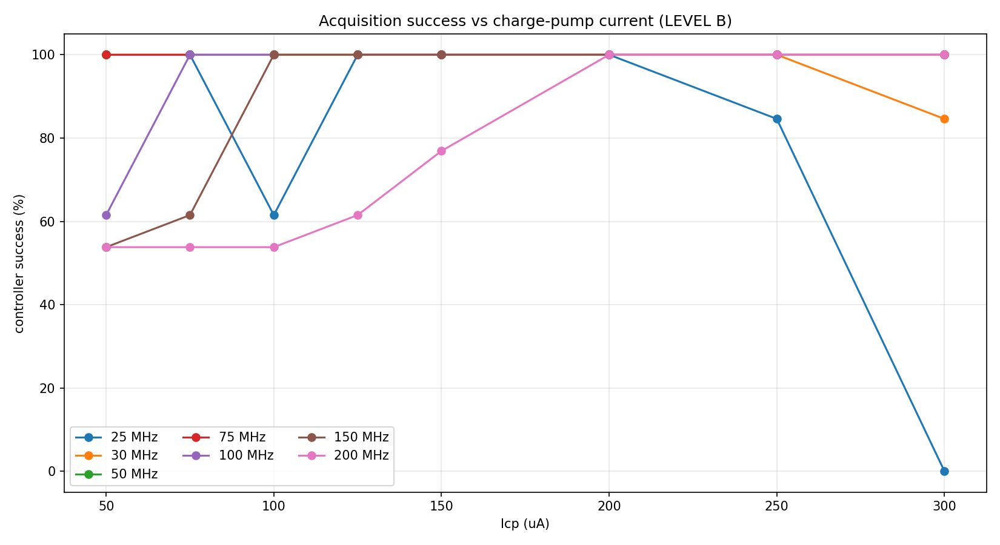
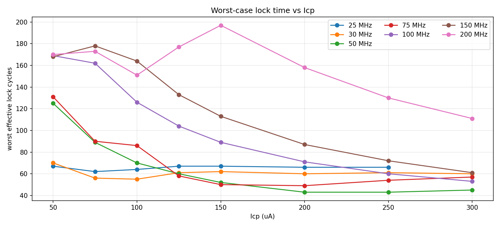
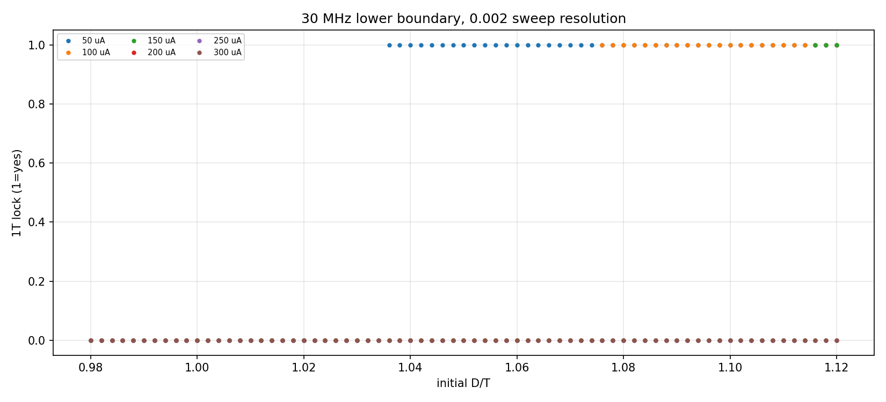
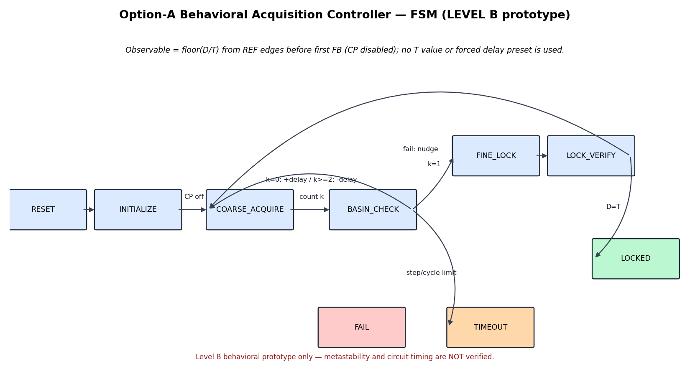

# 8-Phase Multiphase Delay-Locked Loop for Sky130 SoCs

**Chipalooza Challenge #4 — Draft Proposal v0.1**

| Field | Value |
|---|---|
| Document status | **Draft v0.1 for internal review only — not submission-ready** |
| Date | 2026-11-21 |
| Submission date | 2026-11-23 |
| Evidence level | **Level A analytical and Level B behavioral only** |
| Levels C/D | **Not started / out of scope in this draft** |
| Architecture status | **Provisional.** No official architecture, baseline, specification, or validated result file has been changed. |
| Authorship | Design authority remains with the user. No CV, team, institutional, sponsor, or equipment details are included in this main document. |

---

## 1. Document control and review status

This document responds to the Chipalooza Challenge #4 proposal requirement for a written description of the IP block, its I/O, function, target specification, and measurement test plan. Equipment lists and designer CVs are to be sent as separate attachments, as required by the challenge rules; they are deliberately omitted here.

All quantitative project evidence cited in this draft comes from files already in this repository. External literature is used only as background. No transistor-level, Sky130, extracted, fabricated, or measured result is claimed.

The current official project baseline remains the one recorded in `AGENTS.md`. The acquisition mechanism and candidate interface described in Sections 6–7 are **proposals for review**, not approved architecture changes.

---

## 2. Executive summary

The proposed block is an analog/mixed-signal **eight-phase delay-locked loop (DLL)** intended to generate eight nominally 45°-spaced clock phases from a 25–200 MHz reference, together with a 50% duty-cycle clock and observability ports for integration and test. Target applications include multiphase clocking, interleaved sampling, and SoC clock distribution where a PLL is unnecessary or undesirable.

The principal technical difficulty is not small-signal loop stability; it is **startup basin selection**. A pure delay line has a phase detector response that is periodic in the reference period. A two-latch PFD cannot by itself distinguish a total line delay of `T` from `2T` or `3T`. The existing baseline minimum-delay startup is also incompatible with the measured behavioral 1T capture basin. The proposal therefore investigates a provisional cycle-counting acquisition controller that uses a hardware-observable quantity — the number of reference edges before the first feedback edge — to place the line in the 1T basin before enabling the fine loop.

The strongest available evidence is **Level B behavioral** only:

- The exact-event PFD/loop model was checked from 50 to 5000 substeps per period with identical basin boundaries.
- A behavioral acquisition controller was exercised over 7 frequencies × 13 initial conditions × 3 bands, plus randomized and boundary tests: **406 controller runs**.
- A fixed-current robustness sweep covered 7 frequencies × 8 charge-pump currents × 13 initial conditions: **728 controller runs**.
- At the proposed behavioral operating point `Icp = 200 µA`, the unchanged controller achieved **91/91 correct-band acquisitions** across 25, 30, 50, 75, 100, 150, and 200 MHz. Detected effective lock time had median **26 cycles** and maximum **158 cycles**; 85/91 cases were ≤100 cycles.
- No controller run in these studies asserted LOCK on a rail or harmonic outcome. This is not a proof of zero false locks in hardware: unaided fine-loop basin maps did produce harmonic settles at low current, and wrong-band cases were not re-swept in Phase 4.

The honest conclusion is that the concept is sufficiently developed to support a **behavioral feasibility proposal**, but not a hardware-feasibility claim. Delay-cell range, PVT corners, transistor-level charge-pump behavior, mismatch, metastability, jitter, power, area, and physical implementation remain unverified. This draft should be reviewed as a technical basis for discussion, not submitted as a final proposal.

---

## 3. Problem statement and motivation

An eight-phase DLL must force the total delay of its voltage-controlled delay line (VCDL) to approximately one reference period `T`, so that the eight tap outputs are separated by `T/8`. The nominal stage-delay requirement is therefore:

| Frequency | Required stage delay `T/8` |
|---:|---:|
| 25 MHz | 5 ns |
| 40 MHz | 3.125 ns |
| 50 MHz | 2.5 ns |
| 60 MHz | 2.083 ns |
| 100 MHz | 1.25 ns |
| 120 MHz | 1.042 ns |
| 200 MHz | 625 ps |

Three coupled risks must be addressed before the target specification can be considered credible:

1. **Rail startup.** A start below the lower 1T basin edge drives the modeled loop to the minimum-delay rail. Starting below 1T did not recover to 1T in the validated behavioral studies.
2. **Harmonic ambiguity.** Edge alignment at `D = T`, `2T`, and `3T` is identical to a two-latch PFD. A lock indicator based only on near-zero phase error cannot distinguish these states.
3. **Band/gain interaction.** The loop gain depends on where the band's delay curve places `D = T`. Low-frequency bands exhibit much larger normalized gain, producing overshoot and rail pockets; low current can instead permit harmonic settles at higher frequencies.

The work completed to date addresses these risks analytically and behaviorally. It does not establish that a Sky130 implementation can meet the proposed numbers.

---

## 4. IP block type and intended application

| Item | Description |
|---|---|
| IP type | Analog/mixed-signal clock-generation and clock-conditioning block |
| Core function | Lock an eight-stage VCDL to one reference period and expose eight phase taps |
| Intended SoC use | Multiphase clock generation, interleaved sampling, clock deskew, and duty-cycle-corrected clock distribution |
| Implementation target | Sky130, 1.8 V core-domain operation |
| Reuse form | Standalone reusable IP plus a Chipalooza harness-slot wrapper, once slot details are available |
| Evidence level today | Analytical/behavioral feasibility study; no physical IP yet |

The block is useful in an SoC because it derives multiple phase relationships from an external reference without frequency multiplication. It is not a substitute for a PLL when frequency synthesis is required.

---

## 5. Functional description

The intended functional sequence is:

1. **Reset/enable:** `RESET_N` and `DLL_EN` place the phase detector, loop control, counter, and state machine in a known state and disable charge-pump correction.
2. **Band selection:** `BAND[1:0]` selects the nominal VCDL delay range. Band overlap is intentional.
3. **Coarse acquisition (proposed):** with the charge pump disabled, the controller counts reference edges between reset and the first feedback edge. Using the controller convention:
   - `k = 0` means `D < T`;
   - `k = 1` means `T ≤ D < 2T`;
   - `k ≥ 2` means `D ≥ 2T`.
   The controller steps a coarse actuator until `k = 1`, flushing the delay line between measurements because delay changes while edges are in flight corrupt the count.
4. **Fine acquisition:** the coarse actuator holds, the charge pump is enabled, and the fine PFD/charge-pump loop reduces the residual phase error.
5. **Lock verification:** LOCK is asserted only when the basin index and steady-state phase evidence are consistent with `D ≈ T`, not merely with edge alignment.
6. **Monitoring:** a selectable tap is routed to `PHASE_MON`, and `VCTRL_MON` exposes the buffered control voltage for bring-up and debug.
7. **Duty-cycle correction:** the baseline concept derives `CLK50` from alternating set/reset events based on phase 0 and phase 4. This concept has not been verified at transistor level.

The prototype controller uses no numerical knowledge of `T` and does not force a `1.3T` preset. The 13 initial conditions in its test matrix are testbench inputs, not information available to the controller.

Frequency changes during operation are **not solved**. A verified loss-of-lock or frequency-change detector and re-acquisition policy remain open work.

---

## 6. Proposed architecture

The provisional architecture contains:

- eight current-starved delay stages with switchable capacitive loading;
- band selection and matched dummy loads;
- a two-latch PFD with reset/dead-zone behavior;
- a charge pump and loop capacitor;
- a proposed coarse actuator and acquisition FSM;
- a 1T-aware lock detector;
- a duty-cycle corrector for `CLK50`;
- tap-monitor and control-voltage-monitor buffers.

**Figure 1 — conceptual only.** This diagram illustrates the proposed acquisition concept; it is not a transistor-level schematic.

The acquisition options investigated were:

| Option | Principle | Assessment |
|---|---|---|
| A | Digital cycle counting | Recommended at Level B; needs coarse actuator and FSM |
| B | Coarse/fine delay split | Useful enabler but does not measure `T` by itself |
| C | Band selection alone | Insufficient; only bounds absolute delay |
| D | Reuse PFD signals for counting | Attractive alternative, but pulse width alone is ambiguous |
| E | Harmonic detector, replica loop, stopwatch, binary search | Literature-supported alternatives with added hardware |

Option A remains the provisional recommendation. It is the only investigated approach that directly measures the dimensionless basin index without prior period knowledge.

Two implementation choices are **recommendations only**:

- `Icp ≈ 200 µA` is the best fixed behavioral current in the tested range. Transistor-level CP design has not been shown to deliver it.
- A coarse code with step size smaller than the narrowest count-1 window is needed. The behavioral model used `Δu = 0.10`; a 4-bit code was qualitatively suggested, but no actuator has been designed.

No official architecture file has been edited and no major component value has been approved.

---

## 7. Candidate interface and I/O

The following is the **candidate interface requested for proposal review**. It is not an approved replacement for the baseline interface.

### 7.1 Proposed external signals

| Direction | Signal | Type | Proposed purpose |
|---|---|---|---|
| Input | `REF_CLK` | Digital clock | Reference clock |
| Input | `RESET_N` | Digital | Asynchronous/synchronous reset as defined by final FSM design |
| Input | `DLL_EN` | Digital | Master enable; CP off and coarse held when disabled |
| Input | `BAND[1:0]` | Digital | Frequency-band selection |
| Output | `CLK50` | Clock | Duty-cycle-corrected clock |
| Output | `LOCK` | Digital | 1T-verified lock indication |
| Output | `PHASE_MON` | Clock | Selected phase tap for test observation |
| Output | `PHASE_SEL[2:0]` | Digital | Listed as an output in the draft candidate; see interface issue below |
| Output | `VCTRL_MON` | Analog | Buffered control-voltage monitor |

### 7.2 Reconciliation with baseline interface

| Candidate name | Baseline counterpart | Status |
|---|---|---|
| `REF_CLK` | `CLK_IN` | Proposed rename only |
| `BAND[1:0]` | `RANGE[1:0]` | Proposed rename only |
| `PHASE_MON` | `TAP_MON` | Proposed rename only |
| `VCTRL_MON` | `VCTRL_MON` | Consistent |
| `CLK50`, `LOCK` | `CLK50`, `LOCK` | Consistent |
| `RESET_N`, `DLL_EN` | Reset/startup control | Candidate makes control pins explicit |
| `PHASE_SEL[2:0]` | `TAP_SEL[2:0]` | **Direction issue:** a mux select is normally an input, but the candidate lists it as an output |
| `PHASE[0:7]` | `PHASE[0:7]` | **Omitted from candidate list** despite being the baseline functional output |
| `CP_CUR` | `CP_CUR` | Omitted; current setting remains an open design decision |
| `MON_DIV[1:0]` | `MON_DIV[1:0]` | Omitted |
| `VC_LOW`, `VC_HIGH` | `VC_LOW`, `VC_HIGH` | Omitted |

These omissions require user decision. The candidate list can describe a **test-observation interface**, but it is not yet a complete replacement for the baseline functional interface.

The official harness provides 1.8 V digital and 3.3 V analog resources, up to 24 digital inputs, 12 digital test outputs, and three dedicated pins. The proposed core operates in the 1.62–1.98 V baseline range. Input/output overvoltage protection and pad assignment must be checked during integration. Shared analog buses should not be relied upon for high-frequency phase measurement.

---

## 8. Target specification

The following values are the existing project baseline. They are **targets**, not achieved results. The official challenge rules leave the target specification to the designer, but changes to the project baseline require explicit user approval.

### 8.1 Supply and environment

| Parameter | Minimum | Typical | Maximum |
|---|---:|---:|---:|
| Supply voltage | 1.62 V | 1.80 V | 1.98 V |
| Temperature | −40 °C | 27 °C | +110 °C |

Process corners: **TT, SS, FF, SF, FS**.

### 8.2 Input clock

| Parameter | Specification |
|---|---|
| Frequency | 25–200 MHz |
| Input duty cycle | 30–70% |
| Input edge time | ≤1 ns |
| Frequency band 0 | 25–60 MHz |
| Frequency band 1 | 50–120 MHz |
| Frequency band 2 | 100–200 MHz |

### 8.3 DLL performance

| Metric | Typical | Maximum / required limit |
|---|---:|---:|
| Lock time | 100 cycles | 400 cycles |
| Static phase error | ±2% of `T` | ±5% of `T` |
| Tap-spacing DNL | ±8% of `T/8` | ±15% of `T/8` |
| `CLK50` duty cycle | 50% | 45–55% |
| Period jitter at 100 MHz | 25 ps RMS | 60 ps RMS |
| Supply current at 100 MHz | 1 mA | — |
| Supply current at 200 MHz | — | 2 mA |
| Phase output load | — | ≥100 fF each |
| False locks | 0 | 0 in startup tests |
| Area | — | ≤0.05 mm² |

The tap-spacing requirement refers to post-layout Monte Carlo 3-sigma performance. A pre-layout behavioral study cannot conclusively establish compliance.

---

## 9. Design approach and implementation status

| Level | Intended work | Current status |
|---|---|---|
| A — Analytical | Loop equations, gain bounds, basin arguments | Completed for the behavioral model; assumptions documented |
| B — Behavioral | Exact-event PFD/loop, controller, sweeps | Completed; primary evidence in this draft |
| C — Transistor-level | Sky130 delay cell, PFD, CP, buffers, DCC | **Not started**; ngspice/Sky130 environment unavailable |
| D — Post-layout | Extraction, Monte Carlo, DRC/LVS, silicon correlation | **Out of scope for this draft** |

The immediate implementation plan after approval is:

1. establish a working open-source Sky130 simulation environment;
2. design and characterize one current-starved delay cell across PVT;
3. verify the transistor-level PFD polarity, reset, and dead zone;
4. design a charge pump capable of the selected behavioral current range;
5. replace planning delay curves with measured transistor-level delay and `Kd`;
6. re-run acquisition sweeps with real delay and CP behavior;
7. integrate the eight-stage line, DCC, monitors, and lock detector;
8. perform layout and post-layout verification in later challenge phases.

This sequence is deliberately conservative: the behavioral current and actuator requirements are targets for circuit design, not evidence that the circuit can meet them.

---

## 10. Verification evidence

### 10.1 Model and test setup

The behavioral evidence uses the validated exact-event PFD model (`pfd_model_v4_final.py`) and the unchanged Phase-3 `AcquisitionController`. Important nominal conditions include `C_loop = 25 pF`, `t_reset = 5 ps`, `t_dead = 10 ps`, 150 fine-loop cycles for basin maps, and 150 substeps per period for the robustness sweep. Boundary studies used a 0.002-T grid. These are single-corner behavioral conditions.

### 10.2 Phase 3: acquisition-controller prototype

| Test set | Runs | 1T acquisitions |
|---|---:|---:|
| Main matrix, all bands | 273 | 128 |
| Main matrix, correct band | 91 | 76 |
| Correct band excluding 25 MHz | 78 | 76 |
| Randomized initial conditions | 35 | 30 |
| Edge-count boundary tests | 84 | 69 |
| **All tests** | **406** | **239** |

The main matrix used 7 frequencies, 3 bands, and 13 initial conditions per band: `min`, `max`, `0.68`, `0.90`, `1.00`, `1.02`, `1.05`, `1.10`, `1.30`, `1.50`, `1.95`, `2.10`, and `2.50`.

At the original `Icp = 300 µA`, 25 MHz failed `13/13` in the correct band. This was traced behaviorally to excessive low-frequency loop gain, not to coarse placement.

### 10.3 Phase 4: fixed-current robustness

The robustness sweep covered 7 frequencies × 8 currents × 13 initial conditions = **728 controller runs**. At `Icp = 200 µA`:

| Frequency | Success | Worst detected lock time |
|---:|---:|---:|
| 25 MHz | 13/13 | 66 cycles |
| 30 MHz | 13/13 | 60 cycles |
| 50 MHz | 13/13 | 43 cycles |
| 75 MHz | 13/13 | 49 cycles |
| 100 MHz | 13/13 | 71 cycles |
| 150 MHz | 13/13 | 87 cycles |
| 200 MHz | 13/13 | 158 cycles |
| **Total** | **91/91** | **158 cycles** |

Across all 728 runs, the measured worst effective lock time was **197 cycles** at **200 MHz and 150 µA**. No harmonic LOCK assertion occurred in the controller results.

**Figure 2 — available/verified Level B plot.**

**Figure 3 — available/verified Level B plot.**

### 10.4 Boundary and non-monotonic behavior

At 30 MHz, the lower 1T edge from the 0.002-T sweep moved monotonically with current:

| `Icp` | Lower edge `D/T` |
|---:|---:|
| 50 µA | 1.036 |
| 75 µA | 1.056 |
| 100 µA | 1.076 |
| 125 µA | 1.096 |
| 150 µA | 1.116 |
| 200–300 µA | No 1T point in 0.980–1.120 |

Controller recovery from 1.00/1.01/1.02 T was 5/5 for currents from 50 to 250 µA, but only 2/5 at 300 µA.

The sweep also found non-monotonic rail pockets: at 25 MHz and 100 µA, the exact maximum-delay actuator endpoint railed while a nearby interior point locked; at 25 MHz and 250 µA, an interior point near `u = 0.03` railed. These are properties of the behavioral engine and must be resolved with circuit-level models before hardware conclusions.

**Figure 4 — available/verified Level B plot.**

**Figure 5 — available/verified behavioral prototype diagram.**

### 10.5 What the evidence does not establish

The controller tests do not cover PVT, device mismatch, charge injection, leakage, metastability of asynchronous edges, current-switching transients, transistor-level delay limits, supply noise, load drive, power, or area. Wrong-band combinations from Phase 3 were not re-swept in Phase 4; the original 91 wrong-band `UNSETTLED` cases remain relevant.

---

## 11. Feasibility assessment by specification

| Specification | Target | Status | Basis and limitation |
|---|---|---|---|
| Frequency/acquisition range | 25–200 MHz | PASS | Behavioral only; 91/91 correct-band at 200 µA |
| Delay-cell range | `tstage = T/8` | UNVERIFIED | Planning curves only; no Sky130 cell simulation |
| Lock time | ≤400 cycles | PASS | Level B detected cycles; 158 max at 200 µA. Typical 100-cycle target not met by all cases |
| Static phase error | ±5% `T` max | UNVERIFIED | No transistor-level implementation or final candidate-architecture result |
| Tap-spacing DNL | ±15% of `T/8` max | UNVERIFIED | Requires real mismatch and post-layout Monte Carlo |
| `CLK50` duty cycle | 45–55% | UNVERIFIED | DCC concept only; no transistor-level timing or load simulation |
| Period jitter | ≤60 ps RMS | ESTIMATE | Earlier analytical estimate suggested supply sensitivity could dominate; no verified noise simulation |
| Supply current | 2 mA @200 MHz max | ESTIMATE | Earlier Level A estimate only; no operating-point or transient-current measurement |
| Area | ≤0.05 mm² | UNVERIFIED | No layout or device-area estimate |
| Phase output load | ≥100 fF each | UNVERIFIED | Output buffers not designed |
| False locks | 0 in startup tests | PASS | Scope-limited: no controller false/harmonic LOCK assertions; unaided maps did show harmonic settles |
| Input duty 30–70% | Support required | UNVERIFIED | DCC and input buffer behavior not simulated at transistor level |
| PVT robustness | Five corners, 1.62–1.98 V, −40 to +110 °C | UNVERIFIED | All sweeps are nominal/single-corner behavioral |

No ESTIMATE or UNVERIFIED item in this table is converted to PASS.

---

## 12. Test plan for validation and measurement

The final test plan must combine pre-silicon verification with post-silicon measurement. Detailed equipment lists are submitted separately and are not part of this document.

### 12.1 Pre-silicon verification

| Test | Method | Exit criterion |
|---|---|---|
| Delay-cell PVT characterization | Transistor-level simulation of one cell over TT/SS/FF/SF/FS, voltage, and temperature | Measured delay range and `Kd` documented; compare with `T/8` plan |
| PFD/CP validation | Transistor-level transient; polarity, reset, dead zone, UP/DOWN matching, leakage | Correct polarity and no unintended LOCK indication |
| Acquisition re-sweep | Full loop with measured delay curves and CP behavior | All correct-band cases acquire 1T or failures fully classified |
| Tap spacing and mismatch | Monte Carlo where supported, otherwise parameterized perturbation | Compare against ±15% of `T/8`; state statistical limits |
| DCC | Input duty 30/50/70% across corners and load | 45–55% `CLK50` duty |
| Jitter | Supply-noise injection/transient-noise capability only if verified in installed tools | ≤60 ps RMS claim only if method is reproducible |
| Power/area | Operating-point/transient current; layout area | ≤2 mA @200 MHz and ≤0.05 mm², or report failure |

### 12.2 Post-silicon measurement outline

1. **Bring-up:** verify supplies, reset polarity, `DLL_EN`, band control, and `VCTRL_MON` range.
2. **Frequency sweep:** measure lock and phase error at 25, 30, 50, 60, 75, 85, 100, 120, 150, 180, and 200 MHz in every applicable band.
3. **Startup sweep:** repeat reset and startup from multiple controlled initial control states; log `LOCK`, `VCTRL_MON`, lock time, and failure mode.
4. **Tap measurement:** select each tap through `PHASE_MON`, de-embed mux and probe skew, and compute spacing and DNL.
5. **Duty-cycle test:** sweep reference duty cycle through 30%, 50%, and 70%.
6. **Jitter test:** measure period jitter at 100 MHz and under defined supply-noise conditions.
7. **Current and area:** measure supply current at 100/200 MHz and report actual core area from layout.
8. **False-lock audit:** classify rail, harmonic, unsettled, and valid 1T outcomes; do not count a phase-aligned harmonic as a valid lock.

The candidate interface exposes only one phase at a time. This makes sequential tap measurement possible but increases sensitivity to mux skew and time-interleaving errors.

---

## 13. Risks, limitations, and open decisions

| Risk / limitation | Impact | Current position / next action |
|---|---|---|
| Official baseline uses minimum-delay startup | Behavioral studies show min-delay starts rail | Propose cycle-count acquisition; **no architecture change applied** |
| `200 µA` current is behavioral only | Circuit may not realize required current or gain | Treat as design target; verify with transistor-level CP |
| Wrong-band cases fail | Phase 3: 91 `UNSETTLED` | Band validity must be enforced or automatic selection designed |
| Lower-basin and rail-pocket sensitivity | Startup failure or false FAIL | Re-study with real cell/CP models; do not treat 0.002-T boundaries as hardware margins |
| Current-switching strategies | Can recover hard cases but add charge discontinuities | Not adopted; switching transients are unsimulated |
| PVT and mismatch | Basin, delay range, DNL, and jitter may shift | Full PVT/Monte Carlo required |
| Metastability | Counter and lock detector may behave differently | Synchronizers and MTBF not analyzed |
| Frequency changes | No re-acquisition policy | Open architecture question |
| Candidate interface ambiguity | `PHASE_SEL` direction and missing `PHASE[0:7]`/status pins | User must resolve before interface is finalized |
| Jitter, power, area | Targets may be binding constraints | No compliant evidence yet |
| Toolchain | No ngspice, xschem, or Sky130 PDK available | Authorization needed before Level C work |

Decisions requested from the user before the next revision:

1. Whether the provisional cycle-counting/coarse-actuator architecture should be adopted as a proposal direction.
2. Whether `200 µA` should be carried forward as a design target rather than a finalized value.
3. Whether the candidate interface is a test-only interface or should replace/reconcile with the baseline functional interface.
4. Whether to authorize toolchain/PDK setup for transistor-level verification.
5. Confirmation that no baseline specification is being relaxed in this draft.

---

## 14. Schedule, deliverables, and submission package

### 14.1 Near-term and challenge schedule

| Date / window | Activity |
|---|---|
| 2026-11-21 | Internal review of Draft v0.1 and audit |
| By 2026-11-23 | Resolve interface/architecture wording; prepare submission package if approved |
| 2026-11-23 | Chipalooza proposal deadline |
| Week of 2026-11-23 | Proposal review |
| 2026-11-23 to 2026-12-28 | Toolchain enablement, transistor-level delay cell, PFD/CP, pre-layout simulation |
| Week of 2026-12-28 | Schematic design and pre-layout simulation review |
| 2026-12-28 to 2027-02-01 | Layout and post-layout verification |
| Week of 2027-02-01 | Layout design review and slot assignment |
| 2027-02-01 to 2027-02-22 | Slot integration |
| Week of 2027-02-22 | Final design review |
| 2027-05-19 | Current published tapeout target |

The 2026-11-23 submission step is conditional on user approval. This draft does not represent completed transistor or layout work.

### 14.2 Deliverables

- `proposal/proposal_v0.1.md` — this draft.
- `proposal/proposal_audit_v0.1.md` — evidence and quality audit.
- Public repository with reproducible scripts, models, schematics, simulations, and documentation, as required by the challenge.
- Separate equipment list and designer CVs; not included in the main proposal.
- Final feasibility summary only after every target has an honest PASS/FAIL/ESTIMATE/UNVERIFIED status.

---

## 15. Figures and references

### 15.1 Figure classification

| Figure | Classification | Note |
|---|---|---|
| Figure 1, conceptual architecture | **Conceptual only** | Valid PNG exists; not a transistor schematic |
| Figures 2–4, robustness plots | **Available / verified** | Generated from Level B CSV data |
| Figure 5, controller state diagram | **Available / verified** | Describes behavioral prototype, not hardware |
| Delay-cell transistor schematic | **Requires transistor-level design first** | Not available |
| PFD/CP/top-level transistor schematics | **Requires transistor-level design first** | Not available |
| Layout floorplan and extracted view | **Needs creation** | Level D; out of scope |
| Measurement setup diagram / photographs | **Needs creation** | Equipment list is a separate attachment |

### 15.2 References

External references are background only and are not used as project performance evidence.

1. B. Razavi, “The Delay-Locked Loop [A Circuit for All Seasons],” *IEEE Solid-State Circuits Magazine*, vol. 10, no. 3, pp. 9–15, Summer 2018, doi: 10.1109/MSSC.2018.2844615.
2. E. R. Booth, *Wide Range, Low Jitter Delay-Locked Loop Using a Graduated Digital Delay Line and Phase Interpolator*, M.S. thesis, Boise State University, 2006; advisor R. Jacob Baker.
3. S. Kim, C.-H. Hyoung, and K.-H. Park, “Wide-range harmonic lock detector with real-time delay measurement of delay-locked loop,” *Electronics Letters*, vol. 51, no. 2, pp. 136–138, 2015, doi: 10.1049/el.2014.3749.
4. X. Wei, Z. Chen, W. Li, and H. Yang, “Harmonic-free and low cost delay-locked loop with a 20–80% input duty cycle,” *Electronics Letters*, vol. 53, no. 2, pp. 70–71, 2017, doi: 10.1049/el.2016.3032.
5. N. Wainstein, E. Avitay, and E. Avner, “Fast-Locking and High-Resolution Mixed-Mode DLL with Binary Search and Clock Failure Detection for Wide Frequency Ranges in 3-nm FinFET CMOS,” arXiv:2501.13238v2, 2025.
6. W. Li and Y. Cao, “Design of Delay Locked Loop with Frequency Division Technique,” WCSE 2016, pp. 563–566, doi: 10.18178/wcse.2016.06.095.
7. H. Nguyen, Y.-S. Yang, and V. Le, *Delay locked loop with harmonic lock and hang prevention architecture*, US Patent 7,209,533 B1, National Semiconductor Corporation, filed 2003, granted 2007.
8. Open Circuit Design, “Rules & Regulations — Chipalooza Challenge #4,” accessed 2026-11-21. `https://opencircuitdesign.com/chipalooza/rules-4.html`
