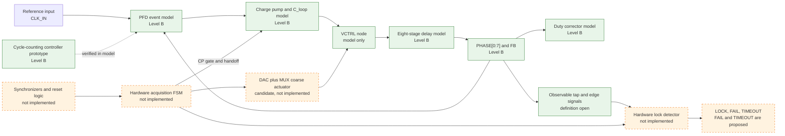

# Proposal v0.2: 8-Phase Delay-Locked Loop for Chipalooza Challenge #4

## 1. Project Title

**Eight-Phase Delay-Locked Loop With Cycle-Counting Coarse Acquisition for Sky130 SoCs**

| Field | Value |
|---|---|
| Document status | Proposal v0.2 for technical review |
| Date | 2026-11-22 |
| Evidence level | Level A analytical and Level B behavioral only |
| Circuit evidence | No Level C transistor-level or Level D post-layout result |
| Baseline specifications | Preserved from `AGENTS.md`; no target relaxed in this revision |
| Architecture authority | `proposal/architecture_decisions_v0.1.md`, decisions D1 through D8 |

---

## 2. Abstract

The proposed block is an analog and mixed-signal eight-phase delay-locked loop (DLL). It accepts a 25 MHz to 200 MHz reference clock and generates eight nominally 45 degree spaced phase taps plus a duty-cycle-corrected clock. The intended use is SoC timing alignment where multiple phases of the same clock are needed without frequency synthesis.

The provisional architecture uses an eight-stage fine delay line, a phase-frequency detector (PFD), a charge pump, a loop capacitor, and a proposed coarse acquisition subsystem. The main acquisition problem is basin selection. A two-latch PFD cannot distinguish an aligned total line delay of `T` from `2T` or `3T`, and the validated behavioral model shows that a minimum-delay start rails instead of reaching the desired 1T equilibrium.

The proposal therefore adopts cycle-counting coarse acquisition as the provisional direction. A controller measures `k = floor(D/T)` from observable reference and feedback edges, steers the coarse delay until `k = 1`, then enables the fine DLL loop. The strongest evidence is Level B behavioral evidence from a validated event-driven PFD model and controller sweeps. No transistor-level, Sky130, extracted, or silicon result is claimed.

---

## 3. Motivation and Applications

An eight-phase DLL creates eight time-interleaved versions of a reference clock. With a 1T locked delay line, adjacent taps are separated by `T/8`, which is 45 degrees of the reference period. The block is useful for:

- multiphase clock generation for digital and mixed-signal blocks;
- timing alignment and deskew at the block or chip level;
- interleaved sampling systems that need staggered sampling edges;
- ADC timing, including sample-and-hold or comparator phase distribution;
- clock distribution where several local phases reduce routing sensitivity;
- interface timing where transmit, receive, or sampling edges must be placed within a clock period.

A DLL delays and aligns clock phases. It does not frequency-multiply like a phase-locked loop (PLL). If a new output frequency is required, a PLL or another synthesis architecture is needed.

The critical design question is not whether the fine loop has a 1T equilibrium. Analytical and behavioral work indicates that it does with correct PFD and charge-pump polarity. The difficult questions are whether the startup sequence reliably reaches the 1T basin, whether the physical delay cell covers the required range, and whether the phase, jitter, power, and area targets can be met in Sky130.

---

## 4. Functional Specifications

The following targets are the existing project baseline from `AGENTS.md`. They remain the proposal targets even where current evidence is incomplete. Status labels distinguish proposed targets from analytical estimates, behavioral evidence, and unverified items.

| Parameter | Target | Status | Basis and limitation |
|---|---|---|---|
| Reference frequency | 25 MHz to 200 MHz | Proposed target; Level B behavioral evidence at 7 sampled frequencies; Unverified across all intermediate frequencies | Seven frequencies were tested in behavioral acquisition sweeps. Continuous frequency coverage is not proven. |
| Supply voltage | 1.62 V minimum, 1.80 V typical, 1.98 V maximum | Proposed target; Unverified | No transistor-level supply sweep has been performed. |
| Temperature | -40 C, 27 C, +110 C | Proposed target; Unverified | No transistor-level temperature sweep has been performed. |
| Process corners | TT, SS, FF, SF, FS | Proposed target; Unverified | No Sky130 corner models have been used. |
| Input clock duty cycle | 30 percent to 70 percent | Proposed target; Level B behavioral evidence; Unverified in circuits | Duty correction was tested in a behavioral model only. |
| Input edge time | 1 ns or less | Proposed target; Unverified | No input buffer or pad model has been simulated. |
| Frequency band 0 | 25 MHz to 60 MHz | Proposed target; Level B behavioral evidence at sampled points; Unverified physically | Planning band used in behavioral model. |
| Frequency band 1 | 50 MHz to 120 MHz | Proposed target; Level B behavioral evidence at sampled points; Unverified physically | Planning band used in behavioral model. |
| Frequency band 2 | 100 MHz to 200 MHz | Proposed target; Level B behavioral evidence at sampled points; Unverified physically | Planning band used in behavioral model. |
| Number of phases | 8 | Proposed target; Level B behavioral evidence | Eight taps exist in the behavioral model. No transistor delay line has been built. |
| Phase spacing | Nominal 45 degrees at 1T lock | Proposed target; Level B behavioral evidence; Unverified physically | Tap spacing depends on real device mismatch and layout. |
| Derived stage delay | 5 ns at 25 MHz, 3.125 ns at 40 MHz, 2.5 ns at 50 MHz, 2.083 ns at 60 MHz, 1.25 ns at 100 MHz, 1.042 ns at 120 MHz, 625 ps at 200 MHz | Level A derivation; Unverified physically | Calculated as `T/8`. Physical delay-cell range is the largest open risk. |
| Charge pump current | 200 uA behavioral target | Proposed design target; Level B behavioral evidence | Best fixed current in the tested behavioral robustness sweep. Not a finalized transistor current. |
| Fine loop capacitor | 25 pF behavioral model value | Level B model condition; proposed study value | Used in the reported behavioral sweeps. Not selected from transistor-level noise or area data. |
| Lock behavior | 1T DLL lock; 100 cycles typical, 400 cycles maximum | Proposed target; Level B behavioral evidence for cycle counts; Unverified hardware lock indication | At 200 uA, detected lock time was median 26 cycles and maximum 158 cycles in the tested sweep. |
| Static phase error | 2 percent of T typical, 5 percent of T maximum | Proposed target; Level B behavioral evidence only; Unverified physically | Behavioral floor is a dead-zone artifact, not silicon evidence. |
| Tap-spacing DNL | 8 percent of T/8 typical, 15 percent of T/8 maximum | Proposed target; Level B behavioral evidence with assumed mismatch; Unverified | Requires real Sky130 mismatch and post-layout Monte Carlo for a compliance claim. |
| CLK50 duty cycle | 50 percent target, 45 percent to 55 percent allowed | Proposed target; Level B behavioral evidence; Unverified physically | Behavioral duty correction used ideal timing and an even-inversion assumption. |
| Period jitter at 100 MHz | 25 ps RMS typical, 60 ps RMS maximum | Proposed target; Level A estimate; Unverified | Supply sensitivity dominates the estimate. No ngspice noise simulation exists. |
| Supply current | 1 mA typical at 100 MHz, 2 mA maximum at 200 MHz | Proposed target; Level A estimate; Unverified | Rough analytical estimate only. No transistor operating-point or transient current exists. |
| Phase output load | 100 fF or more per phase | Proposed target; Unverified | Output buffers are not designed. |
| False locks | 0 in startup tests | Proposed target; Level B behavioral evidence with limited scope; Unverified hardware | No controller test asserted LOCK on a rail or harmonic. Unaided fine-loop sweeps did show harmonic settles. |
| Area | 0.05 mm2 or less | Proposed target; Unverified | No sizing, layout, or credible area estimate exists. |

No ESTIMATE or UNVERIFIED item in this table is converted into a pass.

---

## 5. Proposed Architecture

This section describes the intended architecture, not a completed transistor implementation. No block in this proposal has a Sky130 transistor-level schematic in the current repository.

1. **Reference input.** The functional input is `CLK_IN`, retained from the baseline. Acquisition reports may call the same signal `REF_CLK`. The proposal uses `CLK_IN` as the baseline name and treats `REF_CLK` as an alias only.

2. **Phase-frequency detector.** A two-latch PFD compares the reference with the last delay-line tap. **Status:** existing Level B event-driven model. Transistor-level PFD polarity, reset behavior, and dead zone are not implemented or verified.

3. **Charge pump.** The charge pump converts PFD UP and DOWN pulses into loop-capacitor charge. The behavioral operating point is `Icp = 200 uA`. **Status:** existing Level B model and proposed design target. A transistor-level charge pump is not implemented.

4. **Fine delay control.** The loop capacitor voltage controls the fine delay stages. The behavioral model assumes a monotonic control law and a 25 pF capacitor. **Status:** existing Level B model. Control sensitivity `Kd` is unmeasured.

5. **Delay chain.** Eight current-starved stages produce a total delay near `T` and eight taps near 45 degree spacing. Switchable capacitive loads and matched dummy loads are part of the intended baseline concept. **Status:** studied concept and behavioral model. No transistor delay cell has been simulated.

6. **Feedback path.** The last tap feeds the PFD. The same edge is proposed as an observable for coarse acquisition. **Status:** existing in the behavioral model. Real synchronizers and input behavior are not designed.

7. **Eight phase taps.** `PHASE[0:7]` are functional outputs. **Status:** behavioral model only. Output buffers and load drive are not designed.

8. **Duty-cycle correction.** The baseline concept uses phase 0 and phase 4 rising edges to generate alternating set and reset events for `CLK50`. **Status:** Level B behavioral model and proposed block. It depends on an even number of inversions per stage and has not been verified in circuits.

9. **Coarse acquisition subsystem.** This includes a cycle-counting controller, a coarse actuator, fine-loop handoff, observable lock qualification, and timeout handling. **Status:** behavioral controller prototype exists; hardware FSM, coarse actuator, and hardware lock detector are not implemented.

10. **Lock detector and status.** The future detector should qualify `D ≈ T` using observable signals such as edge count, PFD pulse qualification, selected tap relationships including phase 4, coarse code, supply-limit indicators, and timeout state. **Status:** proposed block. Simulator-only fields such as `final_ratio`, `harmonic_index`, and `settled_pp` are not hardware signals and must not be used as such.

### Proposed block diagram

Solid green blocks are existing Level B models. Dashed orange blocks are proposed or unimplemented hardware.

---

## 6. Acquisition Strategy

Minimum-delay startup is not retained as the preferred proposal architecture. The validated Level B PFD model shows that starts below the lower 1T basin edge converge to the minimum-delay rail and do not recover to 1T. In the exact-event study, all tested starts from `0.90T` through `1.02T` ended at the rail, while starts from above 1T could lock. The old minimum-delay forcing mechanism is therefore kept only as historical baseline context, not as a claimed working acquisition method.

The provisional acquisition method is cycle counting:

`k = floor(D/T)`

| Count | Condition | Meaning | Coarse action |
|---:|---|---|---|
| `k = 0` | `D < T` | Below the desired coarse region, associated with the minimum-delay rail basin | Increase delay |
| `k = 1` | `T <= D < 2T` | Desired coarse region for fine 1T acquisition | Hold coarse setting and start fine lock |
| `k >= 2` | `D >= 2T` | Harmonic region | Decrease delay |

The intended sequence is:

1. Reset the PFD, controller, and charge-pump gating. Place the delay line toward a known coarse starting condition.
2. Disable fine charge-pump correction during counting so the delay does not change while edges are in flight.
3. Count reference edges associated with the first feedback edge to estimate `k`.
4. If `k != 1`, step the coarse actuator in the indicated direction, flush the delay line, and repeat the measurement.
5. When `k = 1` is stable, hold the coarse control, enable the fine PFD and charge pump, and let the fine loop acquire 1T.
6. Assert LOCK only if observable evidence is consistent with 1T and not a harmonic or rail condition.
7. If step, attempt, or time limits are reached, report FAIL or TIMEOUT and do not assert LOCK.

The leading coarse actuator candidate is a DAC plus break-before-make MUX driving `VCTRL`. Switched capacitive loads and a separate coarse delay section remain alternatives. None has been implemented. A 4-bit coarse control is only an initial study point and is not claimed to be sufficient or optimal.

Known limitations are:

- boundary ambiguity near `D ≈ T` and `D ≈ 2T`;
- coincident reference and feedback edges at exact ties;
- synchronizer latency and metastability in real hardware;
- measurement-window and delay-line flush discipline;
- no implemented coarse actuator;
- no implemented or validated hardware lock detector;
- no demonstrated acquisition across PVT, mismatch, or frequency changes during operation.

---

## 7. Interface and Testability

The baseline functional interface remains the reference. Acquisition and debug signals are proposed additions requiring review. No pad assignment is finalized.

### A. Functional interface, baseline reference

| Direction | Signal | Name reconciliation | Purpose |
|---|---|---|---|
| Input | `CLK_IN` | Also called `REF_CLK` in acquisition reports | Reference clock |
| Input | Reset and startup control | Proposed local name `RESET_N`; exact polarity and timing to be defined | Known startup state |
| Input | `RANGE[1:0]` | Also called `BAND[1:0]` in acquisition reports | Frequency-band selection |
| Input | `CP_CUR` | Baseline control input | Charge-pump current setting; encoding not defined in baseline |
| Input | `TAP_SEL[2:0]` | Also called `PHASE_SEL[2:0]` in earlier candidate material | Mux-control input that selects the monitored tap |
| Input | `MON_DIV[1:0]` | No alias | Divider setting for tap monitor path |
| Output | `PHASE[0:7]` | No alias | Eight phase outputs |
| Output | `CLK50` | No alias | Duty-cycle-corrected clock |
| Output | `TAP_MON` | Also called `PHASE_MON` in earlier candidate material | Selected phase tap for observation |
| Output | `VCTRL_MON` | No alias | Buffered control-voltage monitor |
| Output | `LOCK` | No alias | Baseline lock indication |
| Output | `VC_LOW` | No alias | Control voltage low-limit indicator |
| Output | `VC_HIGH` | No alias | Control voltage high-limit indicator |

The earlier candidate interface listed `PHASE_SEL[2:0]` as an output. That is corrected here. A tap selector is a mux-control input. `PHASE[0:7]`, `CP_CUR`, `MON_DIV[1:0]`, `VC_LOW`, and `VC_HIGH` are restored because they are part of the baseline interface.

### B. Configuration and control, proposed wrapper additions

| Direction | Signal | Status | Purpose |
|---|---|---|---|
| Input | `DLL_EN` | Proposed | Master enable and charge-pump gating |
| Input | `ACQ_EN` | Proposed | Enables coarse acquisition without changing functional phase outputs |
| Input | `COARSE_CODE[3:0]` | Proposed study interface | Four-bit coarse control; initial study point only |
| Input | `Icp code` | Proposed, encoding TBD | Selects charge-pump operating current once a circuit exists |

### C. Status outputs, baseline and proposed

| Signal | Status | Purpose |
|---|---|---|
| `LOCK` | Baseline | Indicates qualified 1T lock after lock-detector implementation |
| `VC_LOW` | Baseline | Indicates low control-voltage limit |
| `VC_HIGH` | Baseline | Indicates high control-voltage limit |
| `FAIL` | Proposed addition | Acquisition attempt failed without valid lock |
| `TIMEOUT` | Proposed addition | Acquisition watchdog expired |

`FAIL` and `TIMEOUT` are not baseline requirements. Their polarity, timing, and persistence must be reviewed.

### D. Proposed monitor and test interface

| Signal | Status | Purpose |
|---|---|---|
| `TAP_MON` / `PHASE_MON` | Baseline monitor with naming reconciliation | Sequential tap observation; mux skew must be de-embedded |
| `VCTRL_MON` | Baseline monitor | Bring-up and loop-voltage observation |
| `ACQ_STATE` | Proposed, width TBD | Acquisition FSM state visibility |
| `ACQ_K` | Proposed, width TBD | Observed coarse count for debug only |
| `COARSE_CODE_MON[3:0]` | Proposed study monitor | Coarse-code observation; width follows D6 study point only |

The Chipalooza harness pin budget and pad assignment have not been checked in this proposal. Shared analog buses should not be assumed suitable for high-frequency phase measurement.

---

## 8. Simulation and Verification Evidence

### Level A: analytical

- Loop gain and PFD charge scaling were derived for the behavioral model: `Q_cycle ≈ Icp * frac(D/T) * T`, with per-cycle gain dependent on delay sensitivity and loop capacitance.
- Analytical work establishes that the PFD transfer has zeros at integer multiples of `T`, and that the 1T equilibrium is attracting from above for the modeled polarity and loop gain range.
- Jitter sensitivity was estimated from `dT/T = S * dVDD/VDD` and a 20 mVrms supply-noise assumption. The 60 ps maximum requires `S` below approximately 0.382 in that estimate. This is not a measured cell sensitivity.
- Supply current was roughly estimated as 0.1 mA to 0.5 mA at 100 MHz using an assumed 30 fF per-stage load. This is not a circuit measurement.
- Required stage delay was calculated as `T/8`.

### Level B: behavioral

| Study | Scope | Main verified result | Boundary |
|---|---|---|---|
| Final PFD validation | Exact-event engine, 50 to 5000 substeps per period | No lost edges; exact 5 ps reset timing; identical basin boundaries across timestep; 1T basin from roughly `1.02T` to `1.95T` at the tested 100 MHz condition | Single frequency and nominal model conditions |
| Phase 3 acquisition controller, `Icp = 300 uA` | 406 runs: main matrix, randomized, deterministic, boundary | 239 total 1T acquisitions; 76/91 correct-band acquisitions; no harmonic LOCK assertions | 25 MHz failed all correct-band cases at 300 uA; wrong-band cases failed as expected |
| Phase 4 fixed-current robustness sweep | 7 frequencies x 8 currents x 13 initial conditions = 728 controller runs | Fixed `Icp = 200 uA` achieved 91/91 correct-band acquisitions | Single PVT point; wrong-band cases from Phase 3 were not re-swept |
| Tap-spacing model | 30-sample behavioral Monte Carlo with assumed 1 percent per-stage delay sigma | Mean worst-tap DNL 1.43 percent of `T/8`; 99.7th percentile 2.63 percent of `T/8` | Assumption is not Sky130 mismatch data; 30 samples do not prove 3-sigma yield |
| Duty-cycle model | 50-sample behavioral Monte Carlo per input duty point | Corrected mean 49.96 percent to 49.99 percent for 30, 50, and 70 percent input duty | Assumes even inversion count and ideal timing |

Verified Phase 4 numbers at `Icp = 200 uA`:

| Metric | Result from raw CSVs |
|---|---:|
| Successful correct-band acquisitions | 91/91 |
| Minimum effective lock cycles among successes | 7 |
| Median effective lock cycles among successes | 26 |
| Maximum effective lock cycles among successes | 158 |
| Cases at or below 100 cycles | 85/91 |
| Frequencies sampled | 25, 30, 50, 75, 100, 150, 200 MHz |

Global worst case in the 728-run Phase 4 robustness matrix:

| Field | Value |
|---|---|
| Effective lock cycles | 197 |
| Frequency | 200 MHz |
| Charge-pump current | 150 uA |
| Initial condition | 2.50 |
| Coarse cycles | 18 |
| Fine lock cycle | 179 |
| Final outcome | 1T lock |
| Final ratio | 1.0199 |

These results apply only to the tested behavioral conditions, including the stated model delay curves, `C_loop = 25 pF`, nominal supply and temperature, and the model reset and dead-time settings. The 197-cycle result belongs to the Phase 4 robustness sweep and is not the worst case at the proposed 200 uA operating point.

The following earlier claims remain withdrawn and are not used as evidence: that a DLL cannot lock with a PFD, that `D_min < T/2` makes acquisition impossible, that the 1T basin extends below 1T, and that the old 55/55 startup sweep proves zero false locks.

### Level C: transistor-level

Not performed. No Sky130 MOSFET simulation, delay-cell characterization, transistor PFD, transistor charge pump, or full-loop transistor transient exists.

### Level D: post-layout

Not performed. No layout, extraction, DRC, LVS, or post-layout Monte Carlo exists.

---

## 9. Proposed Verification Plan

| Area | Method | Exit criterion or recorded result |
|---|---|---|
| Functional | Simulate reference, reset, band selection, eight phase outputs, and `CLK50` behavior in the selected flow | Correct output relationships and no undefined startup state |
| Acquisition | Re-run count-based acquisition with real delay and charge-pump models over multiple initial control states and bands | Classify every outcome as 1T lock, rail, harmonic, unsettled, timeout, or failure |
| Lock detector | Stimulate true 1T, 2T, rail, coincident-edge, and noisy cases using observable signals only | LOCK asserted for qualified 1T only; no LOCK on rail or harmonic |
| Frequency range | Test 25, 30, 50, 60, 75, 85, 100, 120, 150, 180, and 200 MHz in applicable bands, with additional points near band edges | Baseline frequency range met or exact failures reported |
| Phase spacing | Measure all tap delays after lock; compute `T/8` spacing, DNL, and INL | Compare with 8 percent typical and 15 percent maximum targets |
| Duty cycle | Sweep input duty at 30, 50, and 70 percent across corners and output load | `CLK50` within 45 percent to 55 percent |
| Jitter | Verify ngspice noise capability before use; inject defined supply noise and measure period jitter; if unavailable, keep the analytical estimate labeled as such | Compare with 25 ps typical and 60 ps maximum at 100 MHz |
| Power | Measure average supply current in transient and operating-point simulations at 100 MHz and 200 MHz | Compare with 1 mA typical and 2 mA maximum targets |
| Area | Estimate device area first, then report actual layout core area | Compare with 0.05 mm2 limit only after layout exists |
| PVT | Sweep TT, SS, FF, SF, FS at 1.62 V, 1.80 V, and 1.98 V at -40 C, 27 C, and +110 C | Record delay range, lock, phase error, duty cycle, current, and jitter per corner |
| Mismatch | Use Sky130 mismatch parameters if supported; otherwise perturb parameters externally and state the method | Report mean, sigma, and extremes without claiming strong yield from small samples |
| Output loading | Simulate each phase output with at least 100 fF load and intended buffer behavior | Phase spacing and duty remain within targets |
| Reset and startup | Sweep reset polarity cases, release timing, and initial control states | Known state and repeatable acquisition or reported failure |
| Failure and timeout | Force wrong band, insufficient actuator range, low and high control limits, and frequency change | FAIL and TIMEOUT behave as specified and LOCK is not falsely asserted |

Pre-silicon work uses simulation. Physical measurement requires fabricated silicon and is outside the current project scope. A future bench plan should include reference clock generation, multichannel phase measurement, low-noise supplies, supply-noise injection, temperature control, and current measurement. That equipment is proposed, not confirmed available.

---

## 10. Implementation Plan

1. **Finalize architecture and interface.** Review D1 through D8, resolve functional versus wrapper signals, and freeze signal names and directions.
2. **Characterize one Sky130 delay cell.** Enable a validated open-source simulation flow first, then simulate a current-starved cell.
3. **Validate delay range and control sensitivity.** Measure delay versus `VCTRL`, `Kd`, monotonicity, and usable control range across bands and corners.
4. **Implement PFD and charge pump.** Verify polarity, reset, dead zone, current matching, leakage, and rail behavior.
5. **Implement fine delay line.** Integrate eight stages, switchable loads, dummy loads, and output buffers.
6. **Investigate coarse actuator.** Compare DAC plus MUX, switched loads, and separate coarse delay using measured transistor behavior.
7. **Implement acquisition and lock detection.** Convert the behavioral FSM into a hardware-realizable state machine with synchronizers, timeout, and observable lock qualification.
8. **Integrate eight phases and duty correction.** Combine phase taps, `CLK50`, monitors, and status outputs.
9. **Test PVT and mismatch.** Run full-corner simulations and a documented mismatch study.
10. **Layout and post-layout verification.** Add layout, extraction, DRC, LVS, and post-layout Monte Carlo only after earlier stages provide a credible design.

All stages are future work. None is claimed complete.

---

## 11. Risks and Open Issues

| Priority | Risk | Current position | Investigation |
|---:|---|---|---|
| 1 | Physical delay-cell range and linearity | 5 ns to 625 ps stage delay is only a baseline derivation; no Sky130 cell exists | Characterize one cell across `VCTRL`, supply, temperature, and all corners |
| 2 | 25 MHz lower boundary behavior | 200 uA solved the tested behavioral case, but boundary and rail pockets exist at other currents | Re-run acquisition with real delay and charge-pump models; sweep fine grid near `D/T = 1` |
| 3 | 200 MHz upper boundary feasibility | Behavioral success exists; physical speed and delay range are unverified | Simulate band 2 cell and buffers at FF, low voltage, high temperature, and maximum load |
| 4 | Coarse actuator implementation | DAC plus MUX is only a candidate; no monotonicity, charge injection, leakage, or PVT data | Design and simulate candidate actuators; compare step size and handoff behavior |
| 5 | Hardware-realizable lock detector | No hardware detector exists; simulator-only classification fields are invalid | Define observable threshold logic and test against 1T, 2T, rail, and coincident-edge cases |
| 6 | Jitter sensitivity | Estimate shows the 60 ps limit depends on supply sensitivity below approximately 0.382 at 20 mVrms | Verify noise tools, measure supply sensitivity, and simulate injected supply noise |
| 7 | Duty-cycle correction | Behavioral result depends on even inversion count and ideal edge behavior | Confirm stage polarity and simulate 30, 50, and 70 percent input duty across corners and load |
| 8 | PVT and mismatch | All acquisition and timing evidence is nominal and behavioral | Run full PVT and a documented mismatch study; state statistical limits |
| 9 | Power and area | Current estimate is coarse; area is unverified | Measure simulated current and produce device-based and layout area estimates |
| 10 | Output load | Buffers are not designed; 100 fF load compliance is unknown | Design buffers and simulate phase outputs with the required load |
| 11 | Interface and pad budget | Baseline and proposed signals are reconciled in this draft but not finalized; no pad assignments exist | Review wrapper split, pin budget, pad types, and high-frequency monitor access |

Additional open issues are frequency-change reacquisition, exact reset polarity and timing, synchronizer MTBF, and the statistical strength of any future Monte Carlo result.

---

## 12. Toolchain and Equipment

### Current behavioral environment

| Item | Status |
|---|---|
| Python | Available, version 3.12.4 on Windows |
| NumPy | Available, version 2.2.4 on Windows |
| SciPy | Available, version 1.16.0 on Windows |
| Matplotlib | Available, version 3.10.1 on Windows |
| pandas | Not installed; analysis has used standard library CSV tooling |
| ngspice | Not available |
| xschem | Not available |
| Sky130 PDK | Not available |
| IIC-OSIC-TOOLS | Not available; image pull was not completed |
| Level C simulation | Blocked |

The environment report records that no Sky130 model files, corner definitions, or verified transient-noise and Monte Carlo capabilities are available.

### Proposed circuit-level environment

The proposed Level C flow is xschem, ngspice, and the Sky130 PDK, preferably through IIC-OSIC-TOOLS if it can be successfully enabled. Tool installation, PDK download, and system configuration are outside this documentation task and require separate authorization.

### Proposed bench equipment

For eventual physical validation, the intended measurements require a programmable reference clock generator, multichannel oscilloscope or equivalent phase measurement setup, low-noise supplies, supply-noise injection hardware, temperature control, current measurement, and suitable probe fixtures. These items are proposed only. No availability or reservation is claimed.

---

## 13. Expected Contribution

The expected contribution is a testable architecture and evidence trail for an eight-phase DLL startup problem, not a claim of a novel DLL topology.

The project can contribute:

- an eight-phase DLL architecture proposal with explicit interface and verification targets;
- investigation of harmonic acquisition and basin-limited startup in a validated behavioral PFD model;
- a cycle-counting coarse acquisition strategy that does not require numerical knowledge of the input period;
- documented Level B behavioral evidence for acquisition at sampled frequencies and initial conditions;
- a conservative verification plan that separates analytical estimates, behavioral evidence, and future transistor-level proof.

Hardware feasibility remains open. The value of the proposal is that the main risks are identified before circuit implementation and that each target has a stated status.

---

## 14. Conclusion

The proposed block is an eight-phase DLL with a provisional cycle-counting coarse acquisition stage followed by fine analog DLL acquisition. It targets the retained 25 MHz to 200 MHz baseline and the existing supply, phase, duty-cycle, jitter, power, load, and area specifications.

The proposal is worth investigating because the acquisition problem is concrete and the behavioral evidence supports a specific path forward. At `Icp = 200 uA`, the Phase 4 fixed-current robustness sweep achieved 91/91 correct-band acquisitions with median 26-cycle and maximum 158-cycle detected lock times. The global worst case in the 728-run matrix was 197 cycles at 200 MHz and 150 uA. These are Level B results only.

Physical evidence is still needed. The most important missing work is a working Sky130 simulation flow, delay-cell characterization, transistor-level PFD and charge pump validation, hardware-realizable acquisition and lock detection, PVT and mismatch verification, output-load testing, jitter measurement, and layout-based area verification. This document is suitable for technical review as a proposal draft. It is not a hardware-feasibility claim and is not a final submission package.

---

## References

Project evidence only:

- `AGENTS.md`: baseline specifications and project phases.
- `proposal/architecture_decisions_v0.1.md`: authority for decisions D1 through D8.
- `results/behavioral_dll.md`: Level B DLL prototype and Level A estimates.
- `results/environment_report.md`: toolchain and PDK availability audit.
- `results/pfd_validation/final_validation/report.md`: exact-event PFD validation and basin results.
- `results/pfd_validation/final_validation/preset_feasibility.md`: 1.3T preset and cycle-counting concept study.
- `results/pfd_validation/acquisition_investigation/report.md`: acquisition option comparison.
- `results/pfd_validation/acquisition_controller/report.md`: Phase 3 behavioral controller study.
- `results/pfd_validation/acquisition_controller/failure_analysis.md`: Phase 3 failure taxonomy.
- `results/pfd_validation/acquisition_controller/coarse_actuator.md`: coarse actuator requirements, not a circuit design.
- `results/pfd_validation/acquisition_robustness/report.md`: Phase 4 fixed-current robustness sweep.
- `results/pfd_validation/acquisition_robustness/failure_analysis.md`: Phase 4 failure analysis.
- `results/pfd_validation/acquisition_robustness/current_sweep.csv`: 56 frequency and current combinations.
- `results/pfd_validation/acquisition_robustness/lock_time.csv`: 728-run lock-time source data.
- `results/pfd_validation/acquisition_controller/acquisition_results.csv`: 406-run Phase 3 source data.
- `results/tables/duty_correction.csv`, `results/tables/tap_spacing_100MHz.csv`, and `results/tables/jitter_sensitivity.csv`: behavioral and analytical supporting tables.

External context:

- Open Circuit Design, Chipalooza Challenge #4 rules, accessed in the v0.1 audit: `https://opencircuitdesign.com/chipalooza/rules-4.html`.

No external academic reference is used as project performance evidence in this revision.
